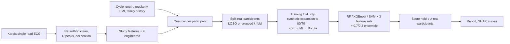

# Early Screening of PCOS from ECG Waveforms

ECG processing pipeline and leakage-safe model comparison (Random Forest, SVM, XGBoost)
for research on wearable-based screening of polycystic ovary syndrome.

> **Research prototype.** Not a medical device and not a diagnostic tool. Nothing in this
> repository has been clinically validated.

## Background

This was a team project at RIT Bengaluru (Medical Electronics). In a pilot study in the
departmental lab, the team recorded ECG (AliveCor Kardia) and other physiological data
from 30 volunteers under its own protocol, with PCOS status self-reported. It built an ECG pipeline
(preprocessing, waveform feature extraction, feature selection) with synthetic class
balancing, and compared Random Forest, SVM and XGBoost with stratified evaluation. The
paper was accepted at AIKP'26 (Paper ID 141).

## What is in this repository, and what is not

| | |
|---|---|
| ✅ The full pipeline, rebuilt as a tested Python package | ❌ Volunteer recordings or labels |
| ✅ A synthetic ECG generator so the pipeline runs end to end | ❌ Any trained model |
| ✅ The original team notebooks and their aggregate results ([`original_study/`](original_study/)) | ❌ The paper PDF |
| ✅ Templates for documenting the protocol and data | |

**Two kinds of code live here.** [`original_study/`](original_study/) holds the notebooks
the team actually ran for the paper, published with the team's permission, plus their
aggregate results; read its README for three important caveats. Everything else is a
later rebuild of the method with tests and stricter evaluation. The rebuild is not the
code that produced the paper's numbers, and running it on the demo data does not
reproduce them. See [`docs/claims_ledger.md`](docs/claims_ledger.md).

## Quick start

```bash
python -m venv .venv && source .venv/bin/activate
pip install torch --index-url https://download.pytorch.org/whl/cpu   # CPU-only PyTorch, needed by SDV
pip install -e ".[dev,study]"
pcos-ecg demo              # synthetic cohort -> features -> study-method evaluation (about 1-2 min)
pytest                     # 73 tests, synthetic data only
streamlit run app/Home.py  # dashboard
```

The `study` extra adds SDV, SDMetrics, Boruta, NeuroKit2, UMAP and SHAP. Without it the
core package still installs, and the tests that need those libraries are skipped.

`pcos-ecg demo` generates 30 made-up participants, the same size as the pilot (an
arbitrary 10 in the positive class, two 30 s recordings each at 250 Hz, plus made-up cycle
length, cycle regularity, BMI and family history). It extracts features, compares the
synthesizers, evaluates every model and writes a report to `runs/`. The class differences
in the generator are arbitrary, so **the demo metrics say nothing about PCOS**.

## Pipeline: the original study's method, evaluated without leakage



| Step | Original study (`original_study/03_Code`) | This repository |
|---|---|---|
| ECG intervals | Estimated with AI assistance from Kardia printouts; no code | NeuroKit2 cleaning, R peaks and wavelet delineation (`signal/nk_features.py`); the built-in scipy detector remains as an alternative |
| P-wave dispersion | Reported as a feature | Single-lead proxy: beat-to-beat spread (95th–5th percentile) of P-wave duration, labelled as such |
| Features | 6 ECG + 4 physiological, plus SDNN/MeanRR, QTc/MeanRR, PWD×QTc, SDNN×QTc | Same names and formulas (`features/study.py`) |
| Synthesizer choice | CTGAN vs Gaussian Copula vs Bayesian network, scored with SDMetrics (`03_1`) | Same comparison (`pcos-ecg compare-synthesizers`) |
| 30 → 150 expansion | Called a Bayesian network; actually a class-conditional Gaussian (`03_2`) | Same method, named honestly, with exact 80/70 class sizes and values clipped to the training range |
| Where synthesis happens | On all participants before splitting | **Changed:** on each fold's training participants only |
| Feature selection | Correlation → mutual information → Boruta on the whole dataset | Same three stages, **changed** to run inside each fold |
| Evaluation | Trained and tested on synthetic rows; 80:20 split and 5-fold CV | **Changed:** every test prediction is for a real, held-out participant; leave-one-subject-out for study data |
| Models | RF, XGBoost, SVM × ECG / physiology / combined (9 experiments) | Same 9, plus a prior-only baseline |
| Ensemble | 0.7 ECG / 0.3 physiology soft vote | Same, evaluated in CV; saved only from demo data |
| Analysis | SHAP, Mann-Whitney U, PCA/t-SNE/UMAP, calibration, decision and learning curves | Same, written to `runs/` |
| Baselines | – | Real data only, class weights, and SMOTE on training participants, all labelled as baselines |

The changes matter: in the original setup the test rows were synthetic copies of the same
people the model trained on, which inflates the scores. Here a score can only come from
predicting someone the model never saw. With about 30 real participants, expect much
lower and less stable numbers than the paper's.

Details: [`docs/architecture.md`](docs/architecture.md),
[`docs/data_dictionary.md`](docs/data_dictionary.md).

## Running on study data

Study files go in `data/private/` (git-ignored); see [`data/README.md`](data/README.md).

Kardia PDF exports can be converted first. List each PDF with a coded ID in
`data/private/kardia/mapping.csv` (columns `file, subject_id, record_id`); the importer reads
only the black trace strokes and never the PDF's text, so names and dates of birth are not
touched.

```bash
pcos-ecg import-kardia --mapping data/private/kardia/mapping.csv --out data/private/ecg_long.csv
cp configs/data_schema.example.yaml configs/local_data.yaml        # edit column names
cp configs/experiment.example.yaml  configs/local_experiment.yaml
pcos-ecg validate-data    --config configs/local_data.yaml
pcos-ecg extract-features --config configs/local_data.yaml
pcos-ecg compare-synthesizers --config configs/local_experiment.yaml   # optional: the 03_1 comparison
pcos-ecg train-evaluate   --config configs/local_experiment.yaml
```

These commands never fall back to demo data: a missing file is an error. If the
smaller class has too few participants for at least two folds, `train-evaluate` stops
and says the comparison cannot be estimated reliably.

## Data protection

How the pilot data were handled:

- **Consent and permission.** The project team collected consent from each volunteer, and
  the pilot ran in the departmental lab with the competent authority's permission. It
  did not go through an ethics committee. A review application has been submitted for
  the larger follow-on study.
- **Coded data.** Volunteers appear in the data files under codes, not names. Only the
  project team holds the list linking codes to people.
- **Volunteer data stays private.** Raw ECG is health data and can identify a person, and
  participants agreed to a study, not to publication. Nothing from the recordings
  (waveforms, features, labels, trained models) is in this repository.

How this repository enforces it:

- **Pseudonymous IDs only.** The pipeline expects participant codes, not names or dates
  of birth.
- **Reports are aggregate.** QC and experiment reports contain counts and metrics only,
  never IDs or rows; a test checks this.
- **Ignored paths.** `data/private/`, local configs, `runs/` and model files are
  git-ignored, and a test fails if any data file is tracked.
- **Synthetic stand-in.** The public demo uses generated signals, labelled as synthetic
  wherever they appear.
- **Documentation gaps are marked.** The protocol is recorded in
  [`docs/research_protocol.md`](docs/research_protocol.md); details not yet documented
  stay "pending" rather than being guessed.

A sibling project, [dp-ecg](https://github.com/pkjx29/dp-ecg), takes the privacy
question further on the public PTB-XL dataset: Laplace and Gaussian mechanisms for
private summary statistics, DP-SGD training of an ECG classifier, and a membership-
inference attack to test what the privacy budget protects in practice.

## Repository layout

```
src/pcos_ecg/   ingestion/ signal/ features/ synthesis/ models/ evaluation/ analysis/ reporting/ demo/ cli.py
original_study/ the team's original notebooks and aggregate results
app/Home.py     Streamlit dashboard (demo-safe; no individual predictions)
configs/        example and demo configs (no private paths)
tests/          pytest suite on synthetic data
docs/           architecture, data dictionary, protocol template, model card, deployment, claims
```

## Limitations

- PCOS status in the pilot was self-reported, not clinically confirmed.
- With 30 participants, cross-validated scores are unstable, and internal CV is not
  external validation.
- Morphology features are automatic single-lead estimates, not expert annotations.
- Synthetic rows, however they are made, are not extra volunteers: the effective sample
  size is the number of real participants.
- P-wave dispersion cannot be measured from one lead; the single-lead proxy is a different
  quantity.
- Bazett's QTc correction is biased at high heart rates.

## License

MIT. See [LICENSE](LICENSE).
