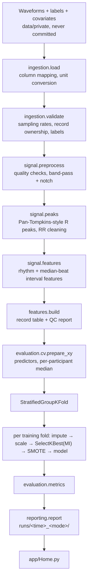

# Architecture

| Module | Responsibility |
|---|---|
| `config.py` | YAML loading, `data_mode` check, path resolution (relative to the working directory) |
| `ingestion/load.py` | Read CSVs, map columns, convert µV→mV, binary label mapping, conflict checks |
| `ingestion/validate.py` | Fatal and non-fatal structural checks; returns counts only |
| `signal/preprocess.py` | `check_quality` (empty, short, non-finite, out of range, saturated, flat) and `bandpass_notch` |
| `signal/peaks.py` | `detect_r_peaks`, `clean_rr` |
| `signal/features.py` | `extract_features`: HR, SDNN, RMSSD, PR, QRS, QT, QTc, T duration, R amplitude |
| `features/build.py` | Runs the above per record; QC report of failure reasons |
| `synthesis/balance.py` | `make_balancer`: SMOTE or a documented skip |
| `models/factory.py` | Baseline, Random Forest, SVM, XGBoost inside one imblearn `Pipeline` |
| `evaluation/cv.py` | Fold count from minority participants, grouped CV, per-fold bookkeeping |
| `evaluation/metrics.py` | Sensitivity, specificity, PPV, F1, balanced accuracy, ROC-AUC, PR-AUC; NaN when undefined |
| `reporting/report.py` | `metadata.json`, `per_fold.csv`, `summary.csv`, `report.md` |
| `demo/synthetic.py` | Toy ECG generator for demos and tests |
| `cli.py` | `demo`, `validate-data`, `extract-features`, `train-evaluate` |

## Failure paths

| Situation | Behaviour |
|---|---|
| Data file missing | `DataValidationError`, exit code 2, points to `data/README.md`; no demo fallback |
| Column missing / label not binary / conflicting labels | `DataValidationError` naming the column or count |
| Band-pass or notch above Nyquist | `FilterConfigError`; cut-offs are never silently changed |
| Recording fails quality checks | Kept in the table with `quality_ok = False`, NaN features, reason counted in QC report |
| Wave not found or implausible | That feature is NaN with a reason; never 0 |
| Too few minority participants for 2 folds | `NotEstimableError`; no scores produced |
| Too few minority participants for SMOTE in a fold | SMOTE skipped for that fold, warning in report |

## Why these choices

- **Leakage control by construction.** Everything that learns sits in one imblearn
  `Pipeline`; samplers run during `fit` only, so SMOTE never sees test rows.
- **Participant as the unit.** Records are collapsed to a per-participant median before
  modelling, and folds are grouped by participant anyway.
- **No tuning.** Fixed defaults; a search on a few dozen people would overfit the folds.
- **SciPy detector instead of NeuroKit2.** Fewer dependencies and every step is readable.
  It is not clinically validated.
