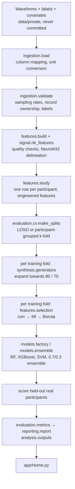

# Architecture

| Module | Responsibility |
|---|---|
| `config.py` | YAML loading, `data_mode` check, path resolution (relative to the working directory) |
| `ingestion/load.py` | Read CSVs, map columns, convert µV→mV, binary label mapping, conflict checks |
| `ingestion/kardia_pdf.py` | Recovers the single-lead trace from Kardia PDF exports (vector strokes, grid-checked scale); never reads the PDF text |
| `ingestion/validate.py` | Fatal and non-fatal structural checks; returns counts only |
| `signal/preprocess.py`, `signal/peaks.py`, `signal/features.py` | Built-in "scipy" backend: quality checks, band-pass + notch, Pan–Tompkins-style R peaks, median-beat intervals |
| `signal/nk_features.py` | "neurokit2" backend: NeuroKit2 cleaning, R peaks, wavelet delineation, per-beat plausibility checks, single-lead P-wave dispersion proxy |
| `features/build.py` | Runs a backend per recording; counts-only QC report |
| `features/study.py` | The study's feature names, engineered features, binary encoding, participant table, feature sets |
| `features/selection.py` | Correlation filter → mutual information → Boruta, called per training fold |
| `synthesis/generators.py` | Class-conditional Gaussian (the study's 30 → 150 method), SDV Gaussian Copula and CTGAN |
| `synthesis/compare.py` | The study's 03_1 synthesizer comparison (SDMetrics, correlation difference, KS, Wasserstein) |
| `synthesis/balance.py` | SMOTE baseline, or a documented skip |
| `models/factory.py` | RF, XGBoost, calibrated SVM and a prior-only baseline in an imblearn `Pipeline` |
| `models/ensemble.py` | 0.7 ECG / 0.3 physiology soft-vote ensemble |
| `evaluation/cv.py` | Splits, per-fold synthesis and selection, out-of-fold predictions, pooled metrics |
| `evaluation/metrics.py` | Sensitivity, specificity, PPV, F1, balanced accuracy, ROC-AUC, PR-AUC; NaN when undefined |
| `analysis/outputs.py` | Mann-Whitney U, calibration, decision and learning curves, SHAP, PCA/t-SNE/UMAP |
| `reporting/report.py` | `metadata.json`, `summary.csv`, `folds.csv`, `feature_selection_frequency.csv`, `report.md` |
| `demo/synthetic.py` | Toy ECG and covariate generator for demos and tests |
| `cli.py` | `demo`, `validate-data`, `extract-features`, `compare-synthesizers`, `train-evaluate` |

## Failure paths

| Situation | Behaviour |
|---|---|
| Data file missing | `DataValidationError`, exit code 2, points to `data/README.md`; no demo fallback |
| Column missing / label not binary / conflicting labels | `DataValidationError` naming the column or count |
| Band-pass or notch above Nyquist | `FilterConfigError`; cut-offs are never silently changed |
| Recording fails quality checks | Kept with `quality_ok = False`, NaN features, reason counted in QC report |
| Wave not found or implausible | That feature is NaN with a reason; never 0 |
| A feature has no values at all | Synthesizers leave it empty; selection drops it |
| Too few real participants of a class in a training fold | No synthesis for that fold; warning in report |
| Boruta keeps nothing | Top-k features by mutual information, counted in the report |
| Too few minority participants for SMOTE (baseline) | SMOTE skipped for that fold, warning in report |
| Too few participants for 2 folds | `NotEstimableError`; use leave-one-subject-out |

## Why these choices

- **Real participants are the test set.** Splits are made on real participants before any
  synthesis, so a test prediction is never for a synthetic copy of a training person.
- **Everything that learns from data runs per training fold:** the synthesizer, the
  feature selection, imputation, scaling and the model.
- **No tuning.** Fixed defaults close to the study's notebooks; a search on about 30
  people would overfit the folds.
- **Metrics on pooled out-of-fold predictions**, because leave-one-subject-out folds hold
  one person each.
- **One OpenMP thread.** XGBoost and PyTorch bundle different OpenMP runtimes that crash
  together on macOS; `pcos_ecg/__init__.py` sets `OMP_NUM_THREADS=1` unless you set it.
